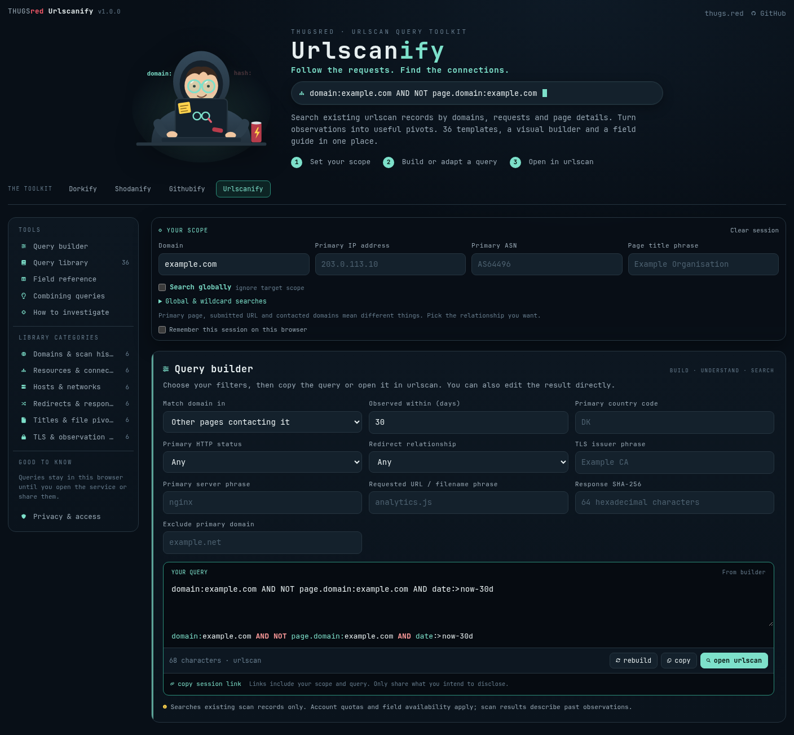
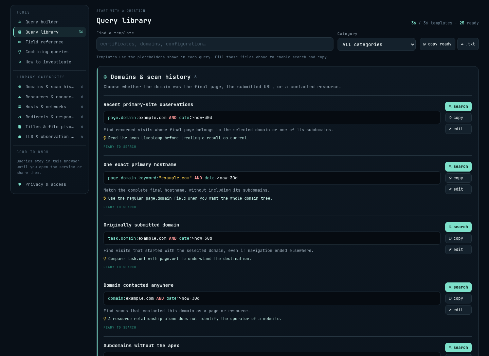

<p align="center">
  <a href="https://thugs.red"></a>
</p>
<h1 align="center">THUGSred Urlscanify</h1>
<p align="center"><strong>Follow the requests. Find the connections.</strong></p>
<p align="center">A small, self-hosted query builder and field guide for investigating existing urlscan records.<br>Made by the Danish hacking community <a href="https://thugs.red">THUGSred</a>.</p>

<p align="center">
  
  
  
  
  <a href="https://thugs.red"></a>
</p>
<p align="center"><a href="https://urlscanify.thugs.red/">Hosted instance</a> · <a href="#run-with-php">Run with PHP</a> · <a href="#existing-apache-vhost">Apache deployment</a> · <a href="#optional-docker-deployment">Docker</a> · <a href="#global--wildcard-searches">Global searches</a></p>

---

**Set a scope. Build a query. Understand what it means.**

Urlscanify gives you a visual builder, 36 annotated templates in 6 categories,
a searchable library and an operator reference in one page. Open the result
in urlscan or copy it into your own workflow.

No API credentials, database, Composer dependencies or frontend build step.
PHP renders the page; JavaScript handles scope, query construction and
exports in the browser. Fonts, icons and artwork are bundled locally.

## Take a look



<details>
<summary><strong>Explore the query library</strong> — ready-to-use searches, explanations and useful pivots</summary>



</details>

*Screenshots are from the hosted instance, using example data. Its optional
THE TOOLKIT navigation is local configuration; standalone installs do not
show links to sibling tools by default.*

## What's inside

| Feature | What it does |
| --- | --- |
| **Domain relationships** | Distinguish the submitted URL, primary page, contacted resources and other pages contacting a domain. |
| **Observation filters** | Combine IPs, ASNs, titles, HTTP status, redirects, TLS metadata, resource names, hashes and dates. |
| **Existing records only** | Generate search links to the scan archive. The app never submits URLs for scanning. |
| **Global search** | Drop target restrictions and use 22 compatible global template variants. Keep useful search criteria. |
| **Learn as you build** | Browse 24 field/operator notes, combining patterns and investigation guidance. |
| **Copy, edit & export** | Adapt a template, copy a query or export the visible ready queries as text. |
| **Optional session memory** | Remember a session only when you opt in. Share it explicitly through a URL fragment. |

Example query:

```text
domain:example.com AND NOT page.domain:example.com AND date:>now-30d
```

Account quotas, search visibility and field availability still apply. Scan time describes a past observation, not necessarily the current website. The default catalog uses standard fields; some advanced fields need a paid plan.

## Run with PHP

Requires PHP **8.1+** with **mbstring**. Node.js is only needed for the optional
query-builder tests.

```sh
git clone https://github.com/kawaiipantsu/thugsred-urlscanify.git
cd thugsred-urlscanify
php -S 127.0.0.1:8080 -t src/public
```

Open **[http://127.0.0.1:8080](http://127.0.0.1:8080)**. The same command is
available as `make dev`; use `make dev PORT=8090` to choose another port.
The built-in PHP server is for local development. An existing Apache/PHP
installation can serve the app directly.

## Existing Apache vhost

For a dedicated vhost with an existing `html/` document root:

```sh
make deploy WEBROOT=/var/www/example/html
```

The directory must already exist. The deployment helper requires PHP and
rsync, validates the catalog and copies **runtime files only**:

```text
your-vhost/
├── html/                # existing document root
│   ├── index.php
│   ├── assets/
│   ├── fonts/
│   ├── favicon.svg
│   └── robots.txt
└── lib/                 # outside the document root
    ├── config.php
    ├── catalog.json
    └── toolkit.php
```

Each app needs its own vhost directory and sibling `lib/`. The helper does
not change Apache, PHP handlers, proxy settings, ownership of the existing
vhost, or middleware files. It preserves deployment-local `lib/local.php`.
The web-server user must be able to read the deployed files.

Alternatively, point a new PHP-enabled web server directly at `src/public/`.
Do not serve the repository root. PHP sends the page's security headers;
no application-specific `.htaccess` file is required.

### Optional local toolkit navigation

Standalone and Docker installations have **no sibling-tool navigation** by
default. If you operate several tools, create a `lib/local.php` beside the
**deployed** `lib/config.php`, outside the document root:

```php
<?php
return ['toolkit' => [
    'urlscanify' => [
        'label' => 'Urlscanify',
        'url' => 'https://search.example.com/',
    ],
    'another-tool' => [
        'label' => 'Another tool',
        'url' => 'https://tools.example.com/',
    ],
]];
```

Include only services you actually host. `src/lib/local.php` is ignored by
Git and excluded from Docker builds. The deployment helper never copies or
replaces local settings. Docker users who deliberately want navigation can
mount a read-only local file at `/var/www/urlscanify/lib/local.php`.

## Optional Docker deployment

```sh
cp .env.example .env        # optional: edit bind address or port
docker compose up -d --build
```

Open **http://127.0.0.1:8080**. The image builds locally from `php:8.4-apache`;
there is no prebuilt image registry to configure.

| Variable | Default | Purpose |
| --- | --- | --- |
| `URLSCANIFY_BIND` | `127.0.0.1` | Host interface. Use `0.0.0.0` if you intend to expose the port on other interfaces. |
| `URLSCANIFY_PORT` | `8080` | Published host port. Change it when another service already uses that port. |

```sh
docker compose logs -f
docker compose down
```

The container runs as `www-data`, with a read-only filesystem, dropped
capabilities and `no-new-privileges`. There is no built-in authentication;
use your existing access controls if the page should be restricted.

## Global & wildcard searches

Enable **Search globally** above the builder. Global mode ignores domain, IP and ASN scope while keeping title, resource, hash and date filters. With the default lookback and no other criteria, `date:>now-30d` searches accessible scans from the last 30 days. `page.domain.keyword:*.dk` matches primary hostnames ending in `.dk`; `domain.keyword:*.dk` also matches contacted resources. Leading wildcards require sign-in. `field:*` means the field exists, not “match everything”.

```text
date:>now-30d
```

Global mode hides templates that have no useful target-free variant.
Switching modes rebuilds the query from the form; a manually edited query
can always be entered directly. Global describes the lack of a target
restriction, not complete access to every record the provider holds.

## Privacy

- Searches open directly in urlscan; the app makes no background service requests.
- Scope and query values remain in memory unless **Remember this session** is enabled.
- **Clear session** removes remembered app state and resets the controls.
- Session links contain scope and query data in the URL fragment. Fragments are not sent in the HTTP request, but are visible to anyone holding the link.
- Exports contain your selected queries. Review both exports and links before sharing.
- The app does not store visitor IP addresses or interpret proxy forwarding headers.

## Development

```sh
make lint                  # catalog structure and PHP syntax
make test                  # Node.js built-in test runner; no npm install
make static                # static HTML and assets in ignored dist/
make help
```

Static exports work without PHP. Configure security headers on the static
host; the PHP response headers and Docker Apache configuration do not run
when serving `index.html`.

| Path | Contents |
| --- | --- |
| [`src/lib/config.php`](src/lib/config.php) | Branding, scope and builder fields. |
| [`src/lib/catalog.json`](src/lib/catalog.json) | Templates, global variants, reference, patterns, guides and official sources. |
| [`src/lib/toolkit.php`](src/lib/toolkit.php) | Optional navigation renderer; no deployment links are bundled. |
| [`src/public/assets/query.js`](src/public/assets/query.js) | Query construction, escaping, validation and service URLs. |
| [`src/public/assets/app.js`](src/public/assets/app.js) | Browser interaction, session state, filtering and export. |
| [`tests/query.test.js`](tests/query.test.js) | Query syntax, global scope, escaping and catalog regression tests. |
| [`docker/`](docker/) | Optional container configuration. |
| [`licenses/`](licenses/) | Notices for bundled fonts. |

Keep local configuration, credentials, exports, browser state and generated
output out of commits. The Git and Docker ignore rules cover common cases;
always review staged files before publishing.

## Official references

[urlscan search syntax](https://docs.urlscan.io/pages/search-general) · [Website scan fields and paid-plan boundaries](https://docs.urlscan.io/pages/search-api-reference) · [urlscan documentation](https://docs.urlscan.io/) · [urlscan Pro capabilities](https://docs.urlscan.io/pages/urlscan-pro) · [Search existing scans](https://urlscan.io/search/)

## Community & credits

Made by **[THUGSred](https://thugs.red)**, the Danish hacking community.
Use for learning and investigations you are authorised to perform.
This is an independent community project, not an official urlscan product.

Code, mascot and logo: THUGSred. No project-wide license has been selected.
JetBrains Mono and Nerd Fonts retain their upstream notices in
[`licenses/`](licenses/).
